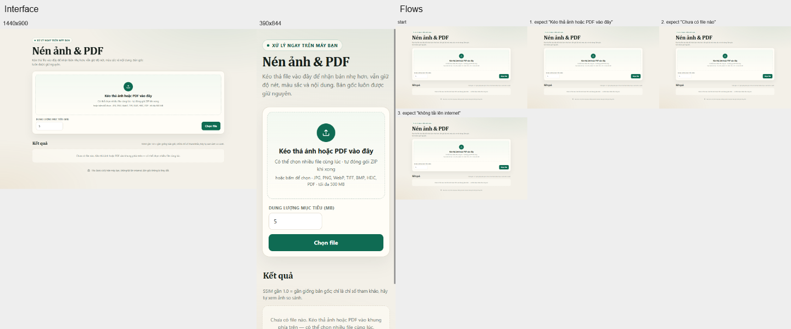

# Proof — resizeAssets

2026-10-31 04:31 UTC · measured verdict: **nothing measured blocks SHIP**

## Flows (run 1793421071371-359685ff-6cb6-4a8e-9239-8d904cfb11d6, 1440x900)

| Flow | Result | Steps | Time | Dead clicks | Console errors |
|---|---|---|---|---|---|
| Mở trang và thấy chỗ thả file | completed | 3 | 1.5 s | 0 | 0 |
| Đặt dung lượng mục tiêu | completed | 3 | 1.6 s | 0 | 0 |

## Interface (run 1793421069288-b9791c08-30e5-43b6-9af2-efa857228651)

- 1440x900: 0 S1, 2 S2 findings
- 390x844: 0 S1, 2 S2 findings

## Not verified

- motion, hover and press states: no --motion run
- contrast over images or gradients (reported as unknown)
- anything outside the flows that ran, and effects a flow cannot see (canvas, sound, clipboard)

