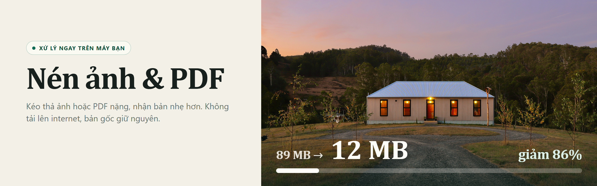
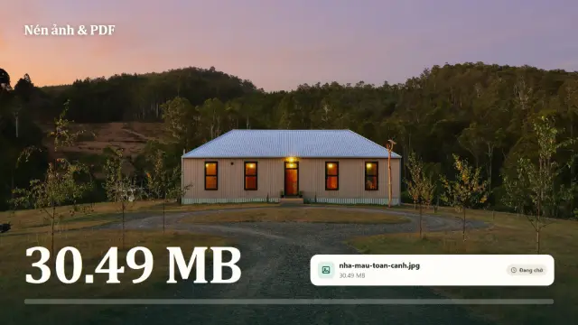
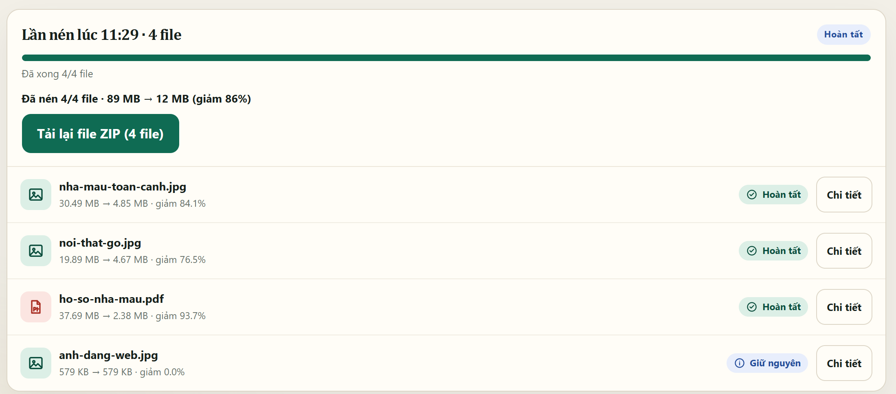
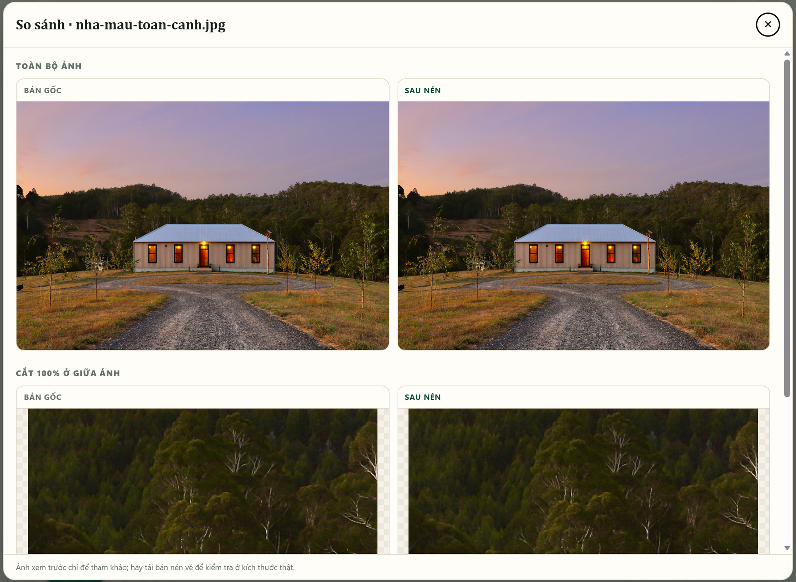
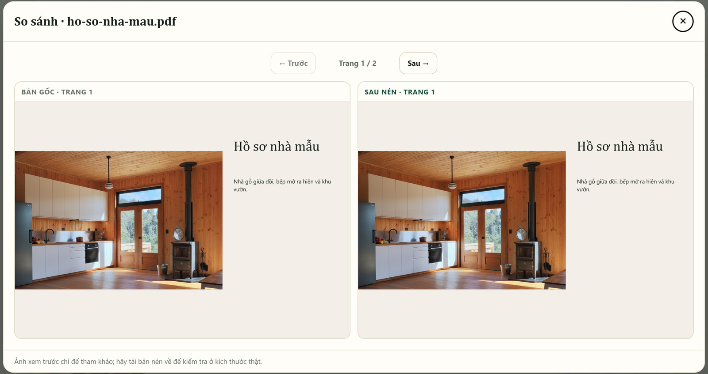

<p align="center">
  
</p>

<h1 align="center">Nén ảnh &amp; PDF</h1>

<p align="center">Ứng dụng nén ảnh và PDF, chạy cục bộ trên Windows hoặc triển khai trên máy chủ: kéo thả file, nhập dung lượng mong muốn, nhận bản nhẹ hơn.</p>

<p align="center">
  <a href="#chạy-nhanh">Chạy nhanh</a> ·
  <a href="docs/DEPLOY_DOKPLOY.md">Deploy Dokploy</a> ·
  <a href="#ứng-dụng-làm-được-gì">Làm được gì</a> ·
  <a href="#đã-kiểm-chứng">Đã kiểm chứng</a> ·
  <a href="#giới-hạn">Giới hạn</a> ·
  <a href="docs/ky-thuat.md">Tài liệu kỹ thuật</a>
</p>

[](.nomi/video/demo.mp4)

<p align="center"><sub>Trailer dựng từ giao diện thật và số của một lần chạy thật, thời gian đã rút gọn (lần chạy thật mất 13 giây). Bấm để xem bản có tiếng.</sub></p>

## Điểm chính

- **Chọn nơi xử lý.** Khi chạy bằng `run.bat`, ứng dụng chỉ mở tại `127.0.0.1:8765`, file không rời máy bạn. Khi dùng bản web trên server, file được tải lên server để xử lý.
- **Bản gốc không bị đụng tới.** Mọi kết quả là một file mới, không bao giờ ghi đè.
- **Một ô duy nhất phải điền:** dung lượng mục tiêu, mặc định 5 MB.
- **Nhiều file một lượt.** Từ 2 file trở lên, kết quả tự đóng gói ZIP và tải về.
- **Nói thẳng khi không đạt.** Không xuống được mục tiêu mà vẫn giữ chất lượng thì ứng dụng báo `target_not_met` và đưa bản nhỏ nhất.

## Chạy nhanh

Cần Windows và Python trên `PATH` (đã chạy với 3.12.10 và 3.14.8). Sau khi tải mã nguồn, nhấp đúp `run.bat`, hoặc gõ:

```powershell
git clone https://github.com/Astramyth/resizeAssets
cd resizeAssets
.\run.bat
```

Lần đầu, lệnh này tạo `.venv` và cài thư viện, có thể mất vài phút. Khi thấy dòng dưới đây, trình duyệt tự mở trang ứng dụng:

```text
Đang chạy tại http://127.0.0.1:8765/  (Ctrl+C để dừng)
```

Muốn chạy từng bước:

```powershell
python -m venv .venv
.venv\Scripts\python -m pip install -r requirements.txt
.venv\Scripts\python app.py
```

## Ứng dụng làm được gì

### Nén cả loạt file

Kéo thả hoặc chọn nhiều file, mỗi file hiện trạng thái riêng. Một file lỗi không dừng các file còn lại, file không hỗ trợ được bỏ qua và liệt kê rõ.



Số thật của lượt nén trên, mục tiêu 5 MB:

| File | Trước | Sau | Giảm | Cách nén | SSIM |
|---|---|---|---|---|---|
| `nha-mau-toan-canh.jpg` | 30.49 MB | 4.85 MB | 84.1% | JPEG q81, giữ 6240×4160 | 0.9793 |
| `noi-that-go.jpg` | 19.89 MB | 4.67 MB | 76.5% | JPEG q92, giữ 6144×4098 | 0.9927 |
| `ho-so-nha-mau.pdf` | 37.69 MB | 2.38 MB | 93.7% | 2 trang, ảnh 300 DPI, q90 | 0.9988 |
| `anh-dang-web.jpg` | 579 KB | 579 KB | 0% | Đã nhỏ hơn mục tiêu, giữ nguyên | 1.0000 |

### Tự kiểm tra bằng mắt

**So sánh** đặt bản gốc cạnh bản nén, cả toàn ảnh lẫn vùng cắt 100% ở giữa. SSIM chỉ là chỉ số tham khảo, nên đây mới là phần nên nhìn.



### Nén PDF mà giữ nguyên chữ

Chỉ ảnh bên trong PDF bị nén lại. Chữ, vector, form và liên kết được giữ, số trang và nội dung chữ được kiểm tra lại sau khi nén. Dữ liệu chỉnh sửa ẩn của Photoshop/Illustrator được bỏ trước, nên có file giảm mạnh mà không cần đụng tới ảnh.



### Định dạng

| Loại | Đầu vào | Đầu ra |
|---|---|---|
| Ảnh không trong suốt | `.jpg` `.jpeg` `.png` `.webp` `.tif` `.tiff` `.bmp` `.heic` `.heif` | `.jpg` |
| Ảnh có vùng trong suốt | `.png` `.webp` `.tif` `.heic` `.heif`… | `.webp` |
| Tài liệu | `.pdf` | `.pdf` |

### Dùng dòng lệnh

```powershell
.venv\Scripts\python compress.py anh.jpg --target 5 --out da-nen
```

```text
File                Before MB  After MB  Ratio  Resolution/DPI          Quality   SSIM    Status
------------------------------------------------------------------------------------------------
anh_compressed.jpg  30.49      4.85      15.9%  6240x4160 -> 6240x4160  JPEG q81  0.9793  ok
```

`--target` mặc định 5 MB. `--out` mặc định là thư mục chứa file gốc. Trong ứng dụng, `1 MB = 1024 × 1024 byte`.

Không muốn tự mở trình duyệt khi chạy `app.py`: đặt biến môi trường `COMPRESS_NO_BROWSER=1`.

## Chạy trên Docker / Dokploy

Repo có sẵn `Dockerfile`, chạy bằng Gunicorn tại cổng `8765`, với người dùng không có quyền root. Không cần database, Redis hoặc volume.

Các phiên bản thư viện của bản Linux được cố định trong `requirements-docker.lock`; bản chạy Windows tiếp tục dùng `requirements.txt`.

```powershell
docker build -t resizeassets:local .
docker run --rm --name resizeassets-local -p 127.0.0.1:8765:8765 resizeassets:local
```

Mở `http://127.0.0.1:8765`. Xem [hướng dẫn Dokploy từng bước](docs/DEPLOY_DOKPLOY.md) để triển khai lên server, gắn tên miền và đặt mật khẩu truy cập.

Giữ **1 worker, 1 thread và 1 replica**: kết quả nén nằm trong bộ nhớ tiến trình; không hỗ trợ chia tải giữa nhiều tiến trình/container. File và kết quả tạm không phải kho lưu trữ lâu dài. Restart/redeploy làm mất khả năng tải lại kết quả cũ.

## Đã kiểm chứng

Ngày 2026-11-01, chuẩn bị triển khai Dokploy:

- Build Docker Linux/Python 3.12 thành công, chạy bằng Gunicorn với user không có quyền root (UID 1000).
- `test_compress.py`: **53/53 kiểm tra đạt** trên Windows/Python 3.14.8 và trong Docker Linux/Python 3.12.
- `test_deployment.py` chạy qua HTTP trên bản Docker cuối: trang chủ, JS/CSS/Motion, upload và tải JPG/PDF, preview ảnh/PDF, ZIP và từ chối mã job sai đều đạt.
- Chưa triển khai trên Dokploy thật, kiểm chứng DNS/HTTPS/xác thực hoặc thử tải nhiều người/file gần 500 MB.

Ngày 2026-10-31, trên Windows 11:

- `test_compress.py`: **53/53 kiểm tra đạt** trên cả Python 3.12.10 và 3.14.8.
- `.\run.bat` chạy từ trạng thái chưa có `.venv`: tạo môi trường, cài thư viện, server lên. Các lệnh trong README đều đã được chạy.
- Trên trình duyệt thật (Edge 156, 1440×900): tải 4 file qua ô chọn file, nén xong trong 13 giây, ZIP tự tải về đủ 4 file, mở So sánh cho ảnh và PDF, không lỗi console. Ở 375 px không tràn ngang.
- File không hỗ trợ bị bỏ qua khi thả vào trang. File gốc giữ nguyên SHA-256 sau khi nén.
- Kiểm tra giao diện bằng Nomi: [2/2 flow hoàn tất](.nomi/proof.md).

Chưa kiểm chứng:

- Kéo thả bằng chuột thật. Đường thả file mới được thử bằng sự kiện tổng hợp trong trình duyệt.
- Chrome và Firefox, máy khác, và file sát giới hạn 500 MB.
- HEIC, TIFF, ảnh trong suốt và PDF có mật khẩu qua giao diện web. Các trường hợp ảnh trong suốt và PDF có mật khẩu đã có trong `test_compress.py`.

## Giới hạn

- **Không phải lúc nào cũng đạt mục tiêu.** Ảnh đã nén mạnh hoặc PDF chỉ có chữ/vector thường không giảm được nhiều.
- Ảnh được encode lại nên có thể mất một ít chi tiết. Ảnh nhiều khung (TIFF nhiều trang, WebP động) chỉ lấy khung đầu.
- Bản PDF đã bỏ dữ liệu ẩn không mở lại được dạng layer trong Photoshop/Illustrator. Bản gốc vẫn còn nguyên.
- PDF có mật khẩu bị từ chối. Hãy mở khóa trước.
- Giới hạn 500 MB mỗi lần tải lên. File rất lớn có thể tốn nhiều RAM.
- Server tích hợp Flask (`python app.py`) chỉ dùng cục bộ. Bản Docker dùng Gunicorn, phù hợp dùng nội bộ có giới hạn truy cập; chưa có quản lý tài khoản, tự dọn file định kỳ hoặc hỗ trợ nhiều replica. File tạm tích tụ cho tới khi được dọn lúc tiến trình thoát bình thường; tiến trình bị kill có thể để lại file tạm. Không gắn volume lưu `/tmp`.

Danh sách đầy đủ, thuật toán và kết quả kiểm thử nằm trong [tài liệu kỹ thuật](docs/ky-thuat.md).

## Ghi công

- [Pillow](https://python-pillow.github.io/), [PyMuPDF](https://pymupdf.readthedocs.io/) (AGPL-3.0 hoặc giấy phép thương mại của Artifex), [NumPy](https://numpy.org/), [Flask](https://flask.palletsprojects.com/), [pillow-heif](https://github.com/bigcat88/pillow_heif).
- [Motion](https://motion.dev/) 12.23.24, kèm sẵn trong `static/vendor`, giấy phép MIT: [xem file](static/vendor/motion.LICENSE.txt).
- Ảnh mẫu trong demo: bộ *Tasmanian House II* của PhotoArch1, giấy phép CC0, trên [Wikimedia Commons](https://commons.wikimedia.org/wiki/File:Tasmanian_House_II.jpg).
